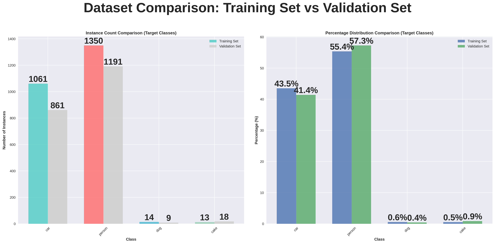

# Object Detection & Instance Segmentation on COCO (YOLOv8)

Training a YOLOv8 segmentation model to find and outline **people, cars, dogs and cakes** in everyday photos from the COCO 2017 dataset, with a data-first workflow: explore the data, clean and filter it, then train and tune.

**Skills shown:** computer vision · exploratory data analysis · data cleaning pipelines · YOLOv8 (Ultralytics) · hyperparameter tuning · model evaluation (mAP)

---

## Results

Validation set: 861 images, 7,581 labelled objects.

| Class | Box mAP50 | Mask mAP50 |
|---|---|---|
| dog | 0.58 | 0.49 |
| person | 0.52 | 0.42 |
| car | 0.46 | 0.38 |
| cake | 0.21 | 0.20 |
| **All classes** | **0.44** | **0.37** |

Inference speed: about 0.6 ms per image on an NVIDIA A100 GPU.

**What this shows:** the model detects dogs, people and cars reasonably well. Cake is much weaker because it has far fewer examples and the objects are often small, partly hidden or clustered on tables. Masks score lower than boxes because tracing an exact outline is harder than drawing a box around an object.

## Approach

1. **Exploratory data analysis:** class balance, objects per image, object sizes and positions, and which classes appear together. The EDA flagged a strong class imbalance (person far more common than the other classes) and many very small objects.
2. **Cleaning and filtering:** kept only the four target classes, checked annotations for errors, and converted COCO polygons into YOLO segmentation format.
3. **Training:** YOLOv8 segmentation model (pre-trained on COCO, fine-tuned here), 640 px images, with short tuning runs to choose training settings before the final training run.
4. **Evaluation:** box and mask mAP per class, precision and recall.

## Example EDA charts

| Train vs validation class balance (sample) | Object positions and sizes |
|---|---|
|  |  |

More charts and a text summary are in [`images/eda/`](images/eda/).

## How to run

Built for **Google Colab with a GPU**.

1. Click the *Open in Colab* badge above and select a GPU runtime.
2. Put the dataset zip in your Google Drive and update `DATASET_PATH` in the notebook to point to it.
3. Run the cells in order: install packages, EDA, cleaning, conversion to YOLO format, training and evaluation.

## Repository contents

| Path | Purpose |
|---|---|
| `RAssignment280825.ipynb` | Full pipeline: EDA, cleaning, YOLO conversion, training, evaluation |
| `images/eda/` | EDA charts and summary report |
| `images/samples/` | Example COCO images |

## Limitations and next steps

- The rare class (cake) needs more examples or targeted augmentation; class-weighted or focal loss could also help.
- The smallest YOLOv8 variant was used for speed. A larger variant (`s` or `m`) would likely raise accuracy at some cost in speed.
- The final cell of the notebook shows a formatting error when printing the summary *after* training finished; the results above come from the completed validation run shown just before it.

---

*MSc Data Science, University of Hertfordshire. COCO images © their respective Flickr owners under the [COCO terms of use](https://cocodataset.org/#termsofuse).*
